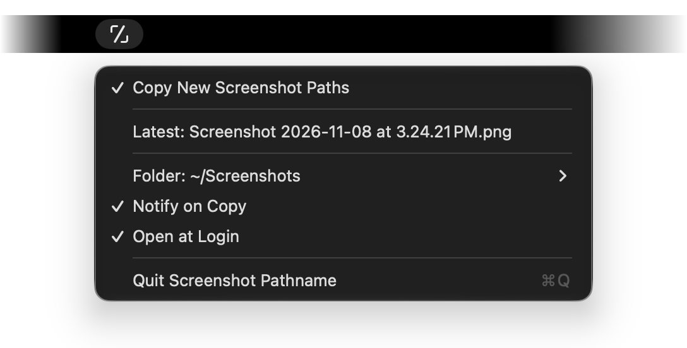

<p align="center">
  
</p>

<h1 align="center">Screenshot Pathname</h1>

<p align="center">
  Take a screenshot. Its file path is already on your clipboard.
</p>

<p align="center">
  macOS 14 or later &nbsp;·&nbsp; Free and open source
</p>

---

AI tools like Claude Code and Codex can look at a screenshot if you give them its file path. Getting that path usually means opening Finder, finding the file and dragging it in, every single time.

Screenshot Pathname does it for you. It sits in your menu bar, and whenever you take a screenshot it copies the file's full path to your clipboard. Paste it into a terminal, a chat or anywhere else that takes a path.

<p align="center">
  
</p>

- **Nothing to remember.** Take screenshots the way you already do; the path is ready to paste half a second later.
- **Works with your screenshot app.** macOS screenshots, and apps like CleanShot X, as long as they save to the same folder.
- **Follows your screenshot folder.** It watches wherever macOS saves screenshots, or a folder you pick.
- **Only new screenshots.** Renaming or moving an old file into the folder won't replace what's on your clipboard.
- **Private.** No account, no tracking, and it never connects to the internet. It doesn't open your images, only notices new files.
- **Small and native.** Made for macOS, on Apple silicon and Intel Macs.

## Install

You need macOS 14 or later and [Xcode](https://apps.apple.com/app/xcode/id497799835) 26 or later (free from the App Store). In Terminal, run:

```bash
git clone https://github.com/racejohnson/screenshot-pathname.git
cd screenshot-pathname
./scripts/install.sh
```

This builds the app, puts it in your **Applications** folder and opens it. To update later, run `git pull` and `./scripts/install.sh` again.

## Use it

Screenshot Pathname has no Dock icon; it lives in your menu bar. Take a screenshot, and when the icon flashes a ✓ the path is on your clipboard. Click the icon for:

- **Copy New Screenshot Paths**: the on/off switch. Uncheck it to pause.
- **Latest**: your newest screenshot. Click it to copy its path again.
- **Folder**: the folder being watched. Choose a different one, go back to the macOS screenshot location, or show it in Finder.
- **Notify on Copy**: also show a notification each time a path is copied. Off by default.
- **Open at Login**: start Screenshot Pathname when you log in.

The icon looks like  while it's copying paths and dims its slash to  while it's paused.

## Questions

**Which folder does it watch?**
The one macOS saves screenshots to: your Desktop, unless you've changed it. To change it, press Shift-Command-5, click **Options**, and choose a location; Screenshot Pathname follows within a few seconds. If you use another screenshot app, point it at the same folder, or choose its folder from the **Folder** menu.

**What counts as a new screenshot?**
An image (PNG, JPEG, HEIC, TIFF or GIF) that appears directly in the folder. Screen recordings, files in subfolders, and older files you rename or move in are ignored.

**The path doesn't work when I paste it into a shell command.**
macOS screenshot names contain spaces, so put quotes around the path: `open "/Users/you/Desktop/Screenshot 2026-11-08 at 3.24.21 PM.png"`. AI tools like Claude Code take the path as it is.

**Notifications don't appear.**
Open System Settings > Notifications > Screenshot Pathname and turn on **Allow notifications**. If the app isn't listed there, quit and reopen it with **Notify on Copy** checked, and choose **Allow** when macOS asks.

**Notifications show a blank icon.**
macOS can hold on to an old copy of the app's icon. Clear its icon cache in Terminal, then try again:

```bash
sudo rm -rf /Library/Caches/com.apple.iconservices.store
killall NotificationCenter
```

**How do I uninstall it?**
Click the menu bar icon, choose **Quit Screenshot Pathname**, and drag the app from Applications to the Trash.

## For developers

It's a Swift package; there's no Xcode project.

```bash
swift test                   # run the tests
./scripts/build-app.sh       # build/Screenshot Pathname.app
./scripts/icon-preview.sh    # render the app icon in every appearance
```

Builds are signed with the first Developer ID or Apple Development certificate in your keychain, or ad-hoc if there's none. Set `SIGN_IDENTITY` to pick one (`-` forces ad-hoc). An ad-hoc build gets a new identity every time, which macOS can treat as a different app, so a free Apple Development certificate (Xcode → Settings → Accounts) is worth having.

## License

[MIT](LICENSE).
